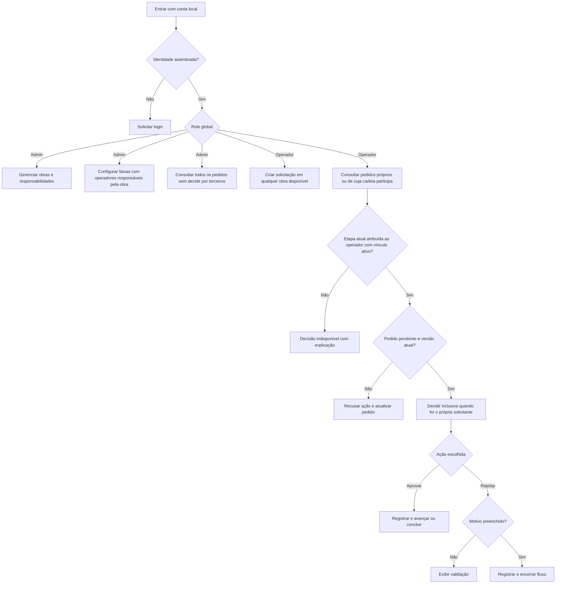
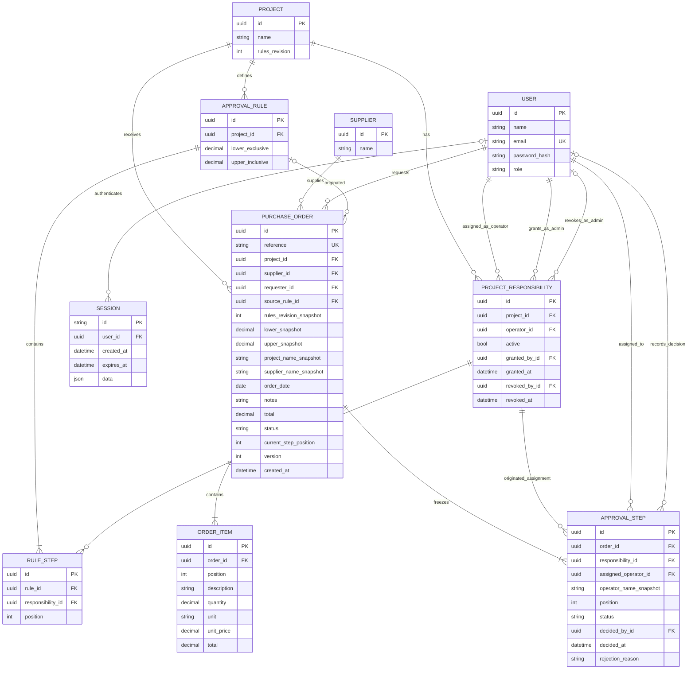
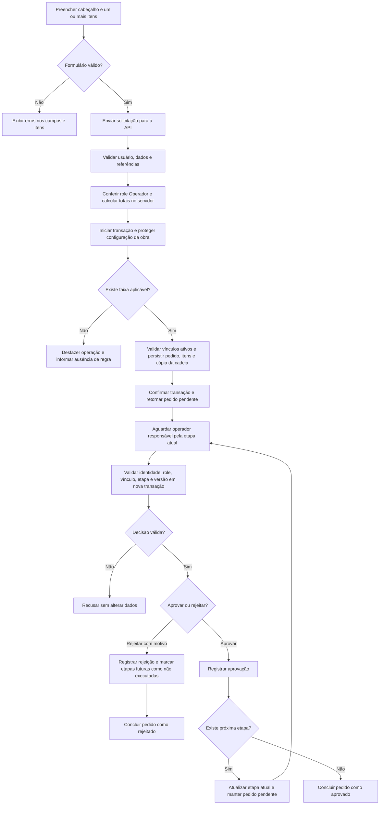

# ObraFlow / Dokimos — Visão geral da solução

Data: 24/10/2026  
Status: domínio planejado para as roles Admin e Operador; SPEC-001 a SPEC-004 verificadas localmente, encerrando M1. A SPEC-004 implementa os quatro endpoints de autenticação, sessão PostgreSQL, CSRF e proteção por role. A SPEC-005 implementa login e estrutura frontend, com E2E/visual ainda pendentes. Funcionalidades de compras e administração continuam planejadas; evidências de validação ficam em cada spec. `/api/docs` mantém o contrato completo, com requisições desabilitadas.
Referência: [enunciado do desafio](../README.md).  
Entrega informada no enunciado: 01/11/2026 às 23h59; o texto não explicita o fuso horário.

Este documento reúne o escopo, as decisões iniciais, a organização técnica, o modelo conceitual, as permissões e as user stories. As escolhas abaixo constituem a referência inicial de implementação e podem ser revistas com registro da justificativa. Diagramas, nomes de campos e endpoints representam a solução planejada, não uma API existente.

Contrato de comunicação detalhado: [contrato da API](contrato-api.md) e [OpenAPI 3.0.3](openapi.json), versão 0.1.0. Esses arquivos fixam nomes de transporte, limites, exemplos e respostas; devem evoluir junto desta visão geral.

## 1. Objetivo e critérios de sucesso

Construir uma aplicação local de pedidos de compra com aprovação sequencial por obra e valor total. A pessoa avaliadora deve conseguir criar pedidos com vários itens, acompanhar as etapas, aprovar ou rejeitar como diferentes usuários e configurar regras sem perder o histórico de pedidos anteriores.

Prioridades alinhadas à avaliação:

| Critério | Peso | Evidência esperada na entrega |
|---|---:|---|
| Funcionamento completo | 25% | Frontend, API e banco funcionando juntos e preservando dados após reinício |
| Regras de alçada | 20% | Faixas inequívocas, cadeia ordenada, rejeição e histórico preservado |
| Qualidade e decisões técnicas | 15% | Módulos coesos, contratos claros e decisões explicáveis |
| Desenho de UI | 20% | Hierarquia, consistência e clareza da próxima ação |
| Estados, responsividade e validações | 10% | Loading, vazio, erro, tentativa novamente e uso em telas pequenas |
| Documentação | 10% | Início do zero, exemplos da API, screenshots e decisões técnicas |

## 2. Escopo

### Incluído

- Três áreas principais de interface: cadastro de pedido, aprovação e configuração de alçadas; acesso por login e área administrativa de obras e responsabilidades.
- Detalhes do pedido com itens, valores, cadeia de aprovação e histórico.
- API para cadastrar e listar obras, usuários e fornecedores; dados demonstrativos já carregados.
- Criação de pedidos com cabeçalho, um ou mais itens e totalização no servidor.
- Configuração de faixas por obra pelo Admin, incluindo inclusão, edição, remoção e ordenação dos operadores responsáveis pelas etapas.
- Duas roles globais persistidas: Admin e Operador; autenticação local com contas de demonstração.
- Gestão de obras e concessão ou revogação de responsabilidades por obra pelo Admin.
- Criação de pedidos pelo Operador em qualquer obra disponível, independentemente de responsabilidade nela.
- Aprovação do próprio pedido quando o Operador for o responsável pela etapa atual.
- Persistência relacional, validação no servidor e tratamento de concorrência.
- Listas paginadas e filtros básicos na aprovação.
- Testes dos comportamentos críticos e documentação de execução local.

### Fora da primeira entrega

- Telas de administração de usuários e fornecedores; esses cadastros permanecem disponíveis por API ao Admin.
- Recuperação de senha, cadastro público, login social e editor de roles ou permissões personalizadas.
- Múltiplas empresas, integração com ERP e serviços externos.
- Edição, exclusão, cancelamento ou reenvio de pedidos já cadastrados.
- Rascunhos persistidos; o formulário permanece apenas no cliente antes do cadastro.
- Aprovações paralelas, delegação, substituição de responsáveis em pedidos enviados e aprovação automática.
- Notificações, anexos, impostos, descontos, frete, múltiplas moedas e orçamento de obra.
- Microsserviços, mensageria, cache distribuído e infraestrutura de produção.

Um pedido rejeitado permanece rejeitado. Para uma nova tentativa, o solicitante cadastra outro pedido.

## 3. Roles, responsabilidades e permissões

### 3.1 Duas roles globais

Cada usuário terá exatamente uma role global persistida em `USER.role`: `admin` ou `operator`, apresentadas como **Admin** e **Operador**. Não existe role nem entidade de domínio chamada Aprovador. Solicitante é o usuário que abriu um pedido; responsável pela decisão é o operador atribuído à etapa atual.

O Admin gerencia obras, usuários, fornecedores, responsabilidades e regras de alçada. O Operador abre solicitações e decide as etapas que lhe foram atribuídas. Ser Admin não concede poder para aprovar ou rejeitar qualquer pedido, nem para pular a cadeia; nesta versão, somente operadores participam das etapas e abrem pedidos.

### 3.2 Responsabilidade por obra

`PROJECT_RESPONSIBILITY` é o vínculo entre um Operador e uma obra. Um Operador pode ser responsável por várias obras e uma obra pode ter vários operadores responsáveis. Esse vínculo não cria outra role global nem permite editar a obra ou suas regras.

O Admin seleciona operadores com vínculo ativo na obra para compor as etapas ordenadas de cada faixa. Responsabilidade torna o operador elegível; somente sua atribuição à etapa atual de um pedido lhe permite decidir. Não há níveis de responsabilidade adicionais, como gerente ou diretor, nesta entrega.

O Operador pode criar um pedido em qualquer obra disponível, mesmo sem vínculo nela. Ter responsabilidade pela obra não garante que ele esteja na cadeia de todos os pedidos dessa obra.

### 3.3 Identidade e acesso

Substituir o seletor livre de usuário por autenticação local com contas carregadas pelo seed. A API obtém usuário e role da credencial ou sessão validada; não aceita identidade, role ou autoria de decisão informadas livremente no corpo ou em cabeçalho demonstrativo. A interface mostra o nome e a role atuais; para avaliar outro usuário, encerrar a sessão e entrar com outra conta.

Senhas são armazenadas somente como hashes e nunca retornadas pela API. A autenticação usará sessão persistida no PostgreSQL, com cookie `obraflow.sid` HttpOnly e validade absoluta de 8 horas a partir do login, sem renovação por atividade. Login regenera a sessão e logout a invalida no banco. A role é definida pelo Admin no cadastro de usuários; não haverá endpoint de autoelevação, cadastro público ou troca de role nesta primeira versão.

O cookie usa `SameSite=Lax`, `Path=/`, sem `Domain` e `Secure` em HTTPS; HTTP é exceção apenas local. Mutações exigem token CSRF vinculado à sessão e verificação de origem. `GET /auth/csrf` fornece o bootstrap técnico público, com sessão anônima persistida por até 15 minutos antes do login. Tokens e identificadores de exemplo no contrato não são credenciais utilizáveis.

### 3.4 Matriz de permissões

| Operação | Admin | Operador | Validação no backend |
|---|---|---|---|
| Consultar obras disponíveis e fornecedores | Sim | Sim, inclusive sem vínculo com a obra | Identidade autenticada; dados necessários ao cadastro |
| Criar e editar obras | Sim | Não | Role Admin e campos válidos |
| Cadastrar usuários e fornecedores pela API | Sim | Não | Role Admin, campos e restrições |
| Listar usuários e responsabilidades para gestão | Sim | Não | Role Admin; operador recebe somente os nomes pertinentes aos pedidos a que tem acesso |
| Conceder ou revogar responsabilidade por obra | Sim | Não | Role Admin, usuário Operador e integridade dos vínculos |
| Configurar faixas e etapas de alçada | Sim | Não | Role Admin; operadores com vínculo ativo na mesma obra |
| Criar pedido em qualquer obra disponível | Não nesta versão | Sim, com ou sem responsabilidade | Role Operador, campos, itens e regra aplicável |
| Listar pedidos e consultar histórico | Todos | Próprios ou em cuja cadeia participa | Filtragem e autorização também na consulta por ID |
| Aprovar ou rejeitar | Não | Somente quando responsável pela etapa atual | Role Operador, vínculo ativo, pedido pendente, etapa e versão esperadas |
| Aprovar o próprio pedido | Não | Sim, se responsável pela etapa atual | Mesmas regras de qualquer decisão; sem avanço automático |
| Decidir etapa futura ou concluída | Não | Não | Rejeitar inclusive em chamada direta à API |
| Alterar itens ou apagar histórico de pedido enviado | Não | Não | Não disponibilizar essas operações |

Ter responsabilidade na obra, isoladamente, não libera consulta a todos os pedidos dela: o Operador vê os próprios pedidos e aqueles em cuja cadeia participa, inclusive depois de concluídos. O Admin tem visão global. A configuração completa das regras fica restrita ao Admin; o Operador recebe a cadeia copiada dos pedidos aos quais tem acesso.

### 3.5 Aprovação própria e remoção de responsabilidade

O Operador pode aprovar a própria requisição manualmente se estiver na etapa atual. Exemplo: Pedro solicita na Obra A e a cadeia é Amanda → Pedro; ele decide somente depois de Amanda. Se a cadeia tiver apenas Amanda, o vínculo de Pedro com a obra não lhe concede uma decisão adicional.

Para preservar os pedidos e evitar etapas sem responsável, a revogação de um vínculo será bloqueada enquanto houver etapas configuradas em regras vigentes ou etapas pendentes/futuras de pedidos em andamento atribuídas àquele vínculo. O Admin deve primeiro ajustar as regras e aguardar a conclusão dos pedidos afetados. Não haverá substituição de operador em pedido enviado nesta entrega. A resposta deve explicar os impedimentos sem aplicar remoção parcial.

Vínculos revogados permanecem registrados com seus autores e instantes de concessão e revogação; não são apagados fisicamente. Reativação é uma nova concessão registrada. Essas alterações não removem decisões históricas nem o acesso do operador aos pedidos de cuja cadeia já participou.



## 4. Decisões de negócio

### 4.1 Faixas e formação da cadeia

O exemplo inicial do enunciado apresenta nomes e ordem inconsistentes. Para esta solução, cada faixa conterá sua **cadeia completa e ordenada**, sem herança de etapas de faixas inferiores.

Uma faixa tem limite inferior exclusivo opcional e limite superior inclusivo opcional:

- Sem limite inferior: cobre valores a partir de zero.
- Com limite inferior: exige `total > limite_inferior`.
- Com limite superior: exige `total <= limite_superior`.
- Sem limite superior: não estabelece teto.
- Ambos ausentes: cobre todos os valores não negativos; só pode existir sem outras faixas sobrepostas.
- Limites informados devem ser não negativos; quando ambos existirem, o superior deve ser maior que o inferior.

Exemplo: até R$ 10.000,00 inclui exatamente R$ 10.000,00; acima de R$ 10.000,00 começa em R$ 10.000,01, pois o total tem precisão de centavos.

| Obra | Faixa | Cadeia completa |
|---|---|---|
| Residencial Horizonte | Até R$ 10.000,00 | Amanda |
| Residencial Horizonte | Acima de R$ 10.000,00 | Amanda → João |
| Escola Jardim | Até R$ 5.000,00 | João |
| Escola Jardim | Acima de R$ 5.000,00 | João → Beatriz |

- Impedir faixas sobrepostas na mesma obra.
- Permitir lacunas e configuração vazia, com indicação de ausência de cobertura.
- Bloquear criação de pedido sem faixa aplicável; nunca aprovar automaticamente.
- Exigir pelo menos uma etapa por faixa; cada etapa referencia um vínculo ativo de responsabilidade entre um Operador e a mesma obra da regra.
- Impedir o mesmo operador em mais de uma etapa da mesma cadeia. Não cadastrar uma entidade Aprovador.
- Ordenar as etapas por posições consecutivas iniciadas em 1.
- Salvar a configuração inteira da obra em uma transação, com controle de revisão para evitar sobrescrever outra edição.

### 4.2 Valores, quantidades e datas

- Moeda única: BRL; apresentação em português brasileiro.
- Quantidade positiva, com até três casas decimais.
- Preço unitário não negativo, com até duas casas decimais.
- Valores acima da precisão aceita devem gerar validação, sem truncamento silencioso.
- Total do item: quantidade multiplicada pelo preço, com aritmética decimal e arredondamento `ROUND_HALF_UP` para duas casas.
- Total do pedido: soma dos totais dos itens já arredondados.
- Exemplo: `0,125 × R$ 0,20 = R$ 0,025`, arredondado para R$ 0,03.
- Pedido com todos os preços iguais a zero é permitido se houver uma faixa cobrindo zero.
- Backend recalcula todos os totais; totais enviados pelo cliente não são aceitos como fonte de verdade.
- Banco usa quantidade `DECIMAL(9,3)`, preço `DECIMAL(12,2)` e total/limites `DECIMAL(18,2)`. Limites de campos e conjuntos são definidos no contrato da API e devem ser refletidos nas validações.
- No JSON, quantidades e valores decimais serão strings com ponto decimal. A interface faz a conversão de apresentação.
- Data do pedido: `YYYY-MM-DD`, sem fuso; não impor restrição adicional a datas passadas ou futuras nesta entrega.
- Instantes de criação e decisão: gerados no servidor, armazenados em UTC e retornados em ISO 8601 com indicação de fuso.
- A interface apresenta instantes no fuso do navegador e identifica esse fuso no histórico.

### 4.3 Preservação dos pedidos

Ao criar o pedido, copiar os limites da faixa, sua revisão e a cadeia ordenada de operadores responsáveis. O pedido não será recalculado a partir da regra atual durante uma decisão.

Persistir também a identificação textual dos operadores atribuídos às etapas, da obra e do fornecedor no pedido ou em suas etapas para preservar o contexto original. Manter referências às entidades de origem, mas impedir exclusão física de obras, usuários, responsabilidades e fornecedores referenciados. Não oferecer essa exclusão na API inicial.

O identificador da regra de origem será opcional no pedido, com `ON DELETE SET NULL`. Remover uma faixa elimina sua aplicabilidade futura, sem apagar a cópia dos limites, da revisão e da cadeia mantida nos pedidos. Atualizar uma faixa também não altera essas cópias.

### 4.4 Situações e decisões

| Registro | Situações planejadas |
|---|---|
| Pedido | `pending`, `approved`, `rejected` |
| Etapa | `waiting`, `pending`, `approved`, `rejected`, `skipped` |

- Pedido novo: pendente, primeira etapa pendente e demais etapas aguardando.
- Aprovação intermediária: concluir a etapa e liberar somente a próxima.
- Última aprovação: pedido aprovado e sem etapa atual.
- Rejeição: motivo obrigatório após remoção de espaços nas extremidades; pedido rejeitado e etapas futuras marcadas como não executadas (`skipped`).
- Pedido concluído: manter ações de decisão desabilitadas com explicação.
- Enquanto pendente, deve existir exatamente uma etapa pendente, correspondente à posição atual persistida no pedido.
- Cada etapa aceita uma única decisão, preservando autor, resultado, motivo e instante.
- Etapas futuras não executadas não representam rejeições adicionais.
- A autoria do pedido não impede sua aprovação pelo mesmo Operador quando a etapa atual estiver atribuída a ele; não realizar aprovação automática.

## 5. Modelo conceitual de entidades

Os nomes abaixo são indicativos; tamanhos, índices e tipos definitivos serão formalizados nas migrations.



Leitura e restrições do modelo:

- Cada pedido pertence a uma obra, a um fornecedor e a um solicitante.
- `USER.role` aceita somente `admin` ou `operator`; roles não são entidades adicionais.
- `SESSION` é persistência técnica de autenticação/CSRF; `user_id` é nulo no bootstrap anônimo e obrigatório após login. A sessão expira pelo prazo registrado no servidor e é removida no logout. O layout físico pode seguir o store de sessão adotado sem mudar o contrato HTTP.
- `PROJECT_RESPONSIBILITY` vincula um Operador à obra; autores de concessão e revogação são usuários Admin. Essa restrição é validada no servidor.
- Permitir somente um vínculo ativo por par obra/operador, usando restrição no banco; novas concessões preservam vínculos anteriormente revogados.
- `RULE_STEP` é uma posição da regra vinculada a uma responsabilidade ativa, não um cadastro de aprovadores.
- A obra da responsabilidade deve coincidir com a obra da regra e do pedido; `assigned_operator_id` deve corresponder ao operador do vínculo copiado na etapa.
- A regra de origem pode deixar de existir; o pedido mantém sua própria cópia da regra e da cadeia.
- `lower_exclusive`, `upper_inclusive` e suas cópias podem ser nulos para representar ausência de limite.
- `current_step_position` é nulo quando o pedido está concluído.
- `decided_by_id`, `decided_at` e `rejection_reason` são nulos antes da decisão; o motivo é obrigatório somente na rejeição.
- A relação do autor da decisão com `USER` é adicional à atribuição de operador. Ambas usam chaves estrangeiras; por regra, os dois usuários devem coincidir.
- Garantir unicidade de posição e responsabilidade por regra; de posição e operador por pedido; e de posição de item por pedido.
- Histórico inicial será composto pela criação do pedido e pelas decisões imutáveis das etapas. Não haverá uma tabela genérica de eventos nesta entrega.
- Ordenar eventos por instante e posição para uma apresentação determinística.

## 6. Fluxo de criação e aprovação



Falhas de validação ou persistência devem desfazer todas as escritas da respectiva operação. Uma requisição recusada por falta de permissão ou conflito não altera o pedido.

## 7. Arquitetura e tecnologias

### 7.1 Monorepo e execução

Um repositório com duas aplicações independentes, coordenadas por pnpm workspaces. Backend como monólito modular; frontend como aplicação React. Não utilizar o modo especial de monorepo do Nest CLI, pois haverá apenas uma aplicação Nest no workspace.

```text
obraflow-case/
├── backend/
├── frontend/
├── e2e/
├── docs/
├── assets/
├── compose.yaml
├── .env.example
├── package.json
├── pnpm-workspace.yaml
├── pnpm-lock.yaml
└── README.md
```

| Responsabilidade | Escolha inicial | Motivo |
|---|---|---|
| Frontend | React + TypeScript + Vite | Interface interativa com tipagem e build dedicado |
| Navegação | React Router | Rotas próprias para telas e detalhes |
| Estilos e componentes | Tailwind CSS + shadcn/ui | Consistência visual e adaptação dos componentes ao produto |
| Formulários | React Hook Form + Zod | Itens dinâmicos e validação próxima dos campos |
| Dados do servidor | TanStack Query + cliente baseado em fetch | Cache, estados de requisição e atualização após operações |
| API | NestJS + TypeScript, com adaptador Express padrão | Módulos, injeção de dependência e estrutura explícita |
| Identidade e autorização | Login local, role no usuário e verificações no backend | Aplicar Admin/Operador e acesso por pedido sem confiar no cliente |
| Sessão e CSRF | Sessão PostgreSQL, cookie HttpOnly de 8h e token vinculado à sessão | Invalidação no logout, prazo absoluto e proteção das mutações |
| Validação da API | DTOs + class-validator + class-transformer | Validação de entrada independente do frontend |
| Persistência | Prisma ORM + PostgreSQL local | Modelo relacional, migrations e transações |
| Cálculo | Aritmética decimal com arredondamento explícito | Evitar cálculos monetários em ponto flutuante binário |
| Documentação HTTP | OpenAPI / Swagger | Contrato consultável e exemplos de consumo |
| Testes do backend | Jest + Supertest | Regras, endpoints e integração com banco |
| Testes do frontend | Vitest + React Testing Library | Interação e validações dos fluxos críticos |
| Testes completos | Playwright | Percursos reais entre interface, API e banco local |
| Ambiente | Docker Compose | Executar frontend, backend e banco sem credenciais externas |

Fixar versões compatíveis e os requisitos de Node.js e pnpm ao criar a base. A biblioteca decimal concreta será escolhida nessa etapa e deverá reproduzir a mesma política no frontend e backend. Não compartilhar instâncias do Prisma nem modelos internos da persistência com o navegador.

### 7.2 Organização do backend

```text
backend/
├── prisma/
│   ├── schema.prisma
│   ├── migrations/
│   └── seed.ts
├── src/
│   ├── main.ts
│   ├── app.module.ts
│   ├── config/
│   ├── database/
│   ├── common/
│   └── modules/
│       ├── auth/
│       ├── projects/
│       ├── project-responsibilities/
│       ├── users/
│       ├── suppliers/
│       ├── approval-rules/
│       └── purchase-orders/
└── test/
```

- Controllers traduzem HTTP; DTOs validam formato; casos de uso executam operações e coordenam transações.
- Funções de domínio concentram regras puras, como cálculo, cobertura de faixas e transições.
- `auth` valida identidade e disponibiliza a role; `projects` gerencia obras; `project-responsibilities` controla concessões e revogações pelo Admin.
- `approval-rules` configura e resolve faixas. `purchase-orders` é responsável por pedido, itens, etapas e decisões.
- Criação e decisão são casos de uso distintos; evitar concentrar toda a funcionalidade em um único serviço extenso.
- Módulos exportam somente os serviços necessários. Não criar dependência circular entre regras e pedidos.
- Quando uma operação atravessar módulos, todas as escritas e leituras protegidas devem usar a mesma transação.
- `common/` recebe apenas recursos técnicos com consumidores reais; não centralizar ali regras de negócio.
- Começar com integração direta e organizada com Prisma; interfaces de repositório adicionais só se houver necessidade concreta.

### 7.3 Organização do frontend

```text
frontend/src/
├── app/                         # Rotas, composição e providers
├── modules/
│   ├── auth/                     # Login, sessão e identificação atual
│   ├── administration/           # Obras e responsabilidades; acesso do Admin
│   ├── purchase-orders/
│   │   ├── index.ts
│   │   ├── pages/
│   │   │   ├── create-order/
│   │   │   └── approvals/
│   │   ├── components/
│   │   ├── hooks/
│   │   ├── services/
│   │   └── types/
│   ├── approval-rules/
│   └── catalogs/
└── shared/
    ├── api-client/
    ├── components/
    └── utils/
```

- Páginas são diretórios, com componentes específicos próximos de seu uso.
- Imports entre módulos passam pelo `index.ts` público de cada módulo.
- Dados da API ficam no TanStack Query; o formulário fica no React Hook Form; estado de interface fica no escopo necessário, sem copiar listas do servidor para um estado global.
- Componentes consomem hooks de dados; requisições passam pelos serviços e pelo cliente HTTP compartilhado.
- A interface adapta navegação e ações à role, mas toda permissão é verificada novamente no backend. Ao encerrar ou trocar a sessão, limpar os dados em cache para não expor resultados da conta anterior.
- Estilos ficam próximos dos componentes, com tokens consistentes. A organização detalhada de estilos será fixada antes da implementação visual.
- Promover componentes para uso compartilhado quando surgirem outros consumidores.
- Não criar um pacote compartilhado apenas por antecipação. Tipos de transporte poderão ser gerados a partir do OpenAPI quando o contrato estiver estabelecido.

## 8. Consistência, integridade e concorrência

| Operação | Estratégia planejada |
|---|---|
| Criar pedido | Validar dados, calcular totais e persistir cabeçalho, itens e etapas em uma transação |
| Conciliar criação com edição de regras | Bloquear a linha da obra durante seleção e cópia da regra e durante alteração da configuração; ambas seguem o mesmo protocolo |
| Alterar configuração | Exigir Admin, validar conjunto e responsabilidades ativas, conferir `expectedRevision`, substituir faixas/etapas e incrementar revisão na mesma transação |
| Conceder ou revogar responsabilidade | Exigir Admin, bloquear obra, validar role Operador e impedimentos; registrar autor/instante e incrementar revisão na mesma transação |
| Aprovar ou rejeitar | Bloquear obra e depois pedido, conferir identidade, role Operador, vínculo ativo, situação, `stepId` e `expectedVersion`; persistir decisão e próximo estado atomicamente |
| Evitar ação sobre tela desatualizada | Recusar versão ou etapa antiga com conflito; recarregar detalhes e lista sem repetir automaticamente a decisão |
| Preservar referências | Chaves estrangeiras, restrições de exclusão e cópias históricas |
| Impedir duplicidade estrutural | Índices únicos para posições, atribuições e vínculos ativos; validações de invariantes no servidor |
| Restringir consultas | Admin consulta todos; Operador consulta somente pedidos próprios ou de cuja cadeia participa, tanto em listas quanto por ID |

Os bloqueios e as restrições deverão ser implementados e testados no PostgreSQL real; chamadas de ORM isoladas não garantem todo esse comportamento. SQL específico, se necessário, deve ser parametrizado.

Criação, alteração de regras, concessão/revogação e decisões seguem a mesma ordem de bloqueios: obra primeiro, pedido depois quando necessário. Isso serializa mudanças de responsabilidade com decisões e evita validar um vínculo já revogado. Remover responsabilidade em uso retorna conflito sem alteração parcial.

Para leitura dos detalhes, obter cabeçalho, itens e etapas em uma visão consistente do banco, usando consulta única ou transação de leitura com isolamento adequado. Listas devem apresentar situação e etapa da mesma versão do pedido; paginação com contagem também deve usar uma visão consistente quando a contagem for retornada.

Desabilitar o submit durante uma requisição reduz cliques repetidos. Não prometer criação de pedido exatamente uma vez após falha de rede: uma chave de idempotência para cadastro fica como evolução. Se houver resultado incerto, orientar a conferir a lista antes de cadastrar novamente. Decisões nunca são repetidas automaticamente pelo cliente.

## 9. Contrato inicial da API

Prefixo proposto: `/api/v1`. Documentação interativa planejada em `/api/docs`.

Detalhes normativos, schemas e exemplos estão no [contrato da API](contrato-api.md) e no [OpenAPI](openapi.json). A tabela abaixo é um resumo.

| Método | Endpoint proposto | Finalidade |
|---|---|---|
| GET | `/auth/csrf` | Bootstrap técnico público de CSRF; sem acesso a dados privados |
| POST | `/auth/login` | Validar credenciais locais e iniciar sessão autenticada |
| POST | `/auth/logout` | Encerrar e invalidar o acesso da sessão |
| GET | `/auth/me` | Retornar identificador, nome e role da conta autenticada |
| GET / POST | `/projects` | Listar para usuários autenticados / cadastrar somente como Admin |
| GET | `/projects/:projectId` | Consultar obra como usuário autenticado |
| PATCH | `/projects/:projectId` | Editar dados da obra como Admin |
| GET / POST | `/users` | Listar / cadastrar usuários como Admin, com role válida |
| GET / POST | `/suppliers` | Listar para usuários autenticados / cadastrar como Admin |
| GET / POST | `/projects/:projectId/responsibilities` | Listar vínculos / conceder responsabilidade a Operador, somente como Admin |
| DELETE | `/projects/:projectId/responsibilities/:id` | Revogar vínculo como Admin, preservando registro e recusando vínculo em uso |
| GET | `/projects/:projectId/approval-rules` | Ler faixas e revisão da configuração como Admin |
| PUT | `/projects/:projectId/approval-rules` | Admin salva conjunto completo com etapas ligadas a responsabilidades e `expectedRevision`; omissão de faixa existente significa remoção |
| POST | `/purchase-orders` | Operador cria pedido em qualquer obra disponível, sem exigir vínculo próprio |
| GET | `/purchase-orders` | Listar respeitando role e acesso; filtrar por obra, situação e minhas pendências |
| GET | `/purchase-orders/:id` | Consultar itens, etapas e histórico se tiver acesso ao pedido |
| POST | `/purchase-orders/:id/decisions` | Operador atribuído decide com `stepId`, `expectedVersion`, resultado e motivo de rejeição |

Convenções:

- Login é a única operação pública de negócio; bootstrap CSRF é exceção técnica. Demais endpoints exigem identidade autenticada. Não expor listagem pública de usuários.
- Backend resolve identidade e role a partir da autenticação. Criação de pedido deriva `requester_id` da conta; decisões derivam `decided_by_id` da conta.
- O cadastro de usuários é restrito ao Admin, aceita apenas as duas roles e nunca devolve hashes de senha.
- Listas com `page` e `pageSize`, padrão de 20 e máximo de 100 registros por página, e ordem determinística. Conjuntos de regras são limitados a 50 faixas e 20 etapas por faixa; pedidos têm até 100 itens.
- Filtro de pendência considera o Operador autenticado e a etapa atual persistida; Admin tem visão global, sem receber poder de decisão.
- Valores decimais em strings; datas e horários conforme seção 4.2.
- Erros com código estável, mensagem compreensível e caminhos de campos quando aplicável, como `items.0.quantity`.
- Convenção inicial de respostas: `400` para entrada ou regra de negócio inválida, `401` para ausência/falha de autenticação, `403` para role ou decisão sem permissão, `404` para recurso inexistente ou pedido fora do acesso de leitura, `409` para conflito de etapa/versão/configuração ou revogação impedida e `500` para falha inesperada.
- Senhas nunca são registradas em logs ou incluídas em respostas. Cookie, bootstrap CSRF, expiração absoluta e invalidação são definidos na seção 2 do contrato.
- Em erros inesperados, retornar mensagem segura e registrar diagnóstico no servidor, sem expor stack trace ao usuário.
- Payloads, limites e respostas já são definidos no contrato e no OpenAPI; o README receberá exemplos reproduzíveis quando a implementação puder ser executada.

## 10. Experiência das telas

### Login e administração

- Login local com contas fictícias documentadas para avaliação; sem seletor livre de identidade.
- Mostrar nome e role da conta atual, permitir sair e restringir a navegação administrativa ao Admin.
- Admin dispõe de área para cadastrar/editar obras e conceder/revogar responsabilidades a operadores por obra.
- Mostrar os impedimentos de uma revogação e orientar a ajustar regras ou concluir pedidos pendentes.
- Operador tem acesso ao cadastro de pedidos e às suas consultas e decisões, sem edição de regras ou responsabilidades.

### Cadastro de pedido

- Iniciar com um item vazio e permitir adicionar, editar e remover itens antes do envio.
- Obra, fornecedor, data, descrição, quantidade, unidade e preço são obrigatórios; observações são opcionais.
- Manter total do pedido visível e totais dos itens não editáveis.
- Mostrar erros no campo correspondente; impedir envio enquanto inválido ou em andamento.
- Sem obras: apresentar estado vazio; orientar o Operador a solicitar cadastro ao Admin e oferecer cadastro na administração para o Admin.
- Listar todas as obras disponíveis ao Operador, inclusive aquelas em que não possui responsabilidade.
- Após sucesso, abrir os detalhes do pedido com a cadeia persistida e devolver confirmação clara.

### Aprovação

- Exibir identificador, obra, fornecedor, data, número de itens, valor, situação e cadeia com etapas concluídas, atual e futuras.
- Filtros por situação, obra e pedidos aguardando a decisão do Operador autenticado; Admin acompanha todos.
- Detalhes com todos os itens e histórico; destacar a próxima ação e seu responsável.
- Aprovação com ação explícita; rejeição abre diálogo com motivo obrigatório.
- Pedidos concluídos mantêm ações desabilitadas com explicação; pedidos atribuídos a outra pessoa indicam o responsável atual.
- Ao encerrar a sessão ou entrar com outra conta, limpar consultas e impedir ações e exposição de dados da identidade anterior.

### Regras de alçada

- Acesso exclusivo ao Admin; selecionar obra e listar suas faixas salvas.
- Exibir limites e cadeia na ordem do fluxo; indicar lacunas de cobertura.
- Permitir criar, editar e remover faixas e etapas; cada etapa seleciona um Operador com responsabilidade ativa na obra.
- Reordenar etapas com botões acessíveis de subir/descer; arrastar não é requisito. Não apresentar um cadastro de Aprovador.
- Manter alterações locais até salvar a configuração inteira; avisar sobre alterações não salvas ao trocar de obra.
- Informar que as mudanças se aplicam a novos pedidos.

### Comportamentos transversais

- Toda lista tem loading, vazio e erro com opção de tentar novamente, inclusive seletores.
- Falhas de envio preservam dados digitados e apresentam orientação contextual.
- Fluxos operáveis por teclado, campos com labels, foco gerenciado em diálogos e situação identificável além da cor.
- Layout utilizável em telas pequenas; itens e tabelas podem adaptar a apresentação sem ocultar dados essenciais.
- Interface operacional, sóbria e consistente, com hierarquia para contexto, valor e próxima ação. Paleta, tipografia e composição serão detalhadas nos esboços.

## 11. User stories e critérios de aceite

### US-01 — Entrar com a role correta

Como usuário, quero entrar com minha conta para acessar as funções de Admin ou Operador correspondentes à minha role.

- Credenciais locais válidas identificam uma conta com exatamente uma das roles: Admin ou Operador.
- Sem autenticação, a API bloqueia operações privadas; sem a role exigida, bloqueia a operação mesmo por chamada direta.
- A interface mostra nome e role, disponibiliza sair e adapta a navegação.
- Ao sair ou entrar com outra conta, dados privados da conta anterior são removidos do cache.
- Informar `role`, solicitante ou autor de decisão arbitrários no cliente não concede acesso nem altera autoria.
- Sessão expira 8 horas após login, inclusive com atividade; logout invalida o registro no banco. CSRF é exigido nas mutações, inclusive login/logout, conforme bootstrap definido no contrato.

### US-02 — Cadastrar pedido com vários itens

Como Operador solicitante, quero informar obra, fornecedor e itens para enviar uma compra à aprovação correta.

- O formulário inicia com um item e permite adicionar, editar e remover N itens antes do envio.
- Posso selecionar qualquer obra disponível, mesmo sem responsabilidade nela; a ausência desse vínculo não bloqueia a criação.
- O servidor registra a conta autenticada como solicitante e não aceita autoria arbitrária.
- Campos obrigatórios, ausência de itens e valores inválidos apresentam erros compreensíveis e impedem o envio.
- Total do item e total geral são calculados; nenhum deles é editável diretamente.
- O servidor recalcula valores e grava pedido, itens e etapas de forma atômica.
- Após sucesso, os detalhes mostram exatamente a cadeia persistida e o pedido continua disponível após reiniciar a aplicação.

### US-03 — Selecionar a alçada pelo total

Como solicitante, quero que a obra e o total de todos os itens determinem a cadeia para encaminhar o pedido corretamente.

- A seleção usa o total arredondado do pedido, e não o valor de um item isolado.
- R$ 10.000,00 pertence à faixa até esse limite; R$ 10.000,01 pertence à faixa acima, quando ambas estiverem configuradas.
- Ausência de faixa aplicável impede a criação e não deixa pedido parcial no banco.
- Um pedido de valor zero só é aceito se coberto por regra.

### US-04 — Consultar pedidos e suas pendências

Como Admin ou Operador, quero listar e filtrar os pedidos a que tenho acesso para encontrar os que exigem minha atenção.

- A lista apresenta todos os campos exigidos no enunciado e a cadeia de aprovação.
- Filtros e paginação são executados no servidor.
- Admin lista todos; Operador lista pedidos próprios ou de cuja cadeia participa, inclusive concluídos.
- Responsabilidade por obra não concede acesso a pedidos de terceiros fora dessa regra.
- O filtro de minhas pendências considera apenas pedidos pendentes cuja etapa atual pertença ao Operador autenticado.
- A lista diferencia carregamento, ausência de resultados e falha recuperável.

### US-05 — Consultar detalhes e histórico

Como usuário, quero entender os itens e as decisões anteriores para avaliar o contexto da compra.

- Os detalhes mostram descrição, quantidade, unidade, preço e total de cada item.
- A cadeia distingue etapas concluídas, atual, futuras e não executadas.
- Decisões mostram autor, instante e resultado; rejeições também mostram o motivo.
- Alterar ou remover uma regra não modifica a cadeia nem os dados históricos do pedido.
- Consultar por ID aplica a mesma restrição da lista; um Operador sem acesso não obtém itens, nomes da cadeia nem histórico daquele pedido.

### US-06 — Aprovar na minha etapa

Como Operador responsável pela etapa atual, quero aprovar o pedido para encaminhá-lo à próxima pessoa ou concluir a compra.

- A API verifica identidade, role Operador, responsabilidade ativa na obra, atribuição atual, pedido pendente, identificador da etapa e versão esperada.
- Uma aprovação intermediária libera somente a próxima etapa e mantém o pedido pendente.
- A última aprovação conclui o pedido como aprovado, sem etapa atual.
- Usuário de etapa futura ou já concluída não consegue decidir por chamada direta à API.
- Admin não pode decidir por um operador nem avançar uma etapa usando sua role administrativa.

### US-07 — Rejeitar com justificativa

Como Operador responsável pela etapa atual, quero registrar o motivo da rejeição para interromper a compra com rastreabilidade.

- Motivo vazio ou composto só por espaços é recusado na interface e na API.
- Rejeição válida registra autor, motivo e instante e conclui o pedido como rejeitado.
- Decisões anteriores são preservadas; etapas futuras ficam não executadas.
- Não é possível aprovar, rejeitar novamente ou reabrir esse pedido.

### US-08 — Entender por que não posso decidir

Como usuário, quero uma explicação quando uma decisão estiver indisponível para saber o próximo passo.

- Pedido concluído mantém as ações de decisão desabilitadas com explicação.
- Pedido atribuído a outra pessoa informa o operador responsável pela etapa atual, quando o usuário possui acesso ao pedido.
- Chamada manual à API também é recusada sem alterar os dados.

### US-09 — Configurar faixas por obra

Como Admin, quero criar, editar e remover faixas para adequar a aprovação ao valor de compra de cada obra.

- Selecionar uma obra carrega suas regras e revisão salvas.
- Limites inválidos e sobreposições bloqueiam o salvamento com erro localizado.
- Lacunas e configuração vazia são permitidas, com aviso sobre compras sem cobertura.
- Salvar aplica todo o conjunto de forma atômica apenas à obra selecionada.
- Uma revisão desatualizada recebe conflito e não sobrescreve alterações de outro usuário.
- Operadores não podem consultar a configuração administrativa nem alterá-la pela interface ou API.

### US-10 — Definir operadores e ordem das etapas

Como Admin, quero atribuir operadores responsáveis e ordenar as etapas para definir a cadeia de cada faixa.

- A lista permite selecionar somente operadores com responsabilidade ativa na obra e alterar posições por teclado.
- Admin, operador sem vínculo ou com vínculo de outra obra não são aceitos como responsáveis pela etapa.
- Cadeia vazia e operador duplicado na mesma faixa são recusados.
- A ordem salva é usada integralmente nos novos pedidos daquela faixa.
- Pedidos anteriores mantêm a ordem que receberam na criação.

### US-11 — Lidar com concorrência

Como Operador responsável pela etapa, quero que o sistema detecte uma decisão já processada para evitar avanços indevidos.

- Duas decisões concorrentes sobre a mesma etapa produzem uma única transição válida.
- A requisição perdedora recebe conflito e não grava decisão parcial.
- A interface informa a mudança e recarrega o pedido sem repetir a decisão.
- Uma aprovação e uma rejeição concorrentes não podem coexistir como decisões da mesma etapa.

### US-12 — Recuperar falhas sem perder contexto

Como usuário, quero entender falhas de comunicação e tentar novamente para continuar meu trabalho.

- Listas com erro oferecem nova tentativa e não se apresentam como listas vazias.
- Formulários preservam o conteúdo em erros de validação ou indisponibilidade.
- Não repetir automaticamente cadastros ou decisões após resultado incerto.
- Em erro de rede após cadastro, orientar a verificar a lista antes de reenviar.

### US-13 — Executar e avaliar localmente

Como pessoa avaliadora, quero iniciar a solução com instruções claras e dados de demonstração para validar os percursos sem serviços externos.

- README informa pré-requisitos, configuração, inicialização, migrations, seed e testes.
- Dados incluem ao menos duas obras, uma conta Admin, três contas Operador, dois fornecedores, responsabilidades por obra, faixas diferentes e pedidos em todos os estados finais e intermediários relevantes.
- As instruções distinguem primeira instalação, reinício e recriação dos dados demonstrativos.
- Recriar dados é uma ação explícita, documentada e nunca executada automaticamente sobre dados existentes.
- README contém screenshots reais e exemplos reproduzíveis dos principais endpoints.

### US-14 — Gerenciar obras

Como Admin, quero cadastrar e editar obras para disponibilizá-las às solicitações dos operadores.

- A área administrativa permite cadastrar e editar dados da obra com validação.
- Toda obra cadastrada fica disponível no cadastro de pedidos dos operadores, sem exigir vínculo prévio.
- Operador não consegue criar ou editar obras pela interface ou por chamada direta à API.
- Edição de nome não altera a identificação histórica copiada em pedidos anteriores.

### US-15 — Conceder e revogar responsabilidades por obra

Como Admin, quero definir quais operadores têm responsabilidade por cada obra para controlar quem pode compor suas cadeias.

- Uma obra aceita vários operadores responsáveis; um operador pode ter responsabilidade em várias obras.
- Não é permitido atribuir responsabilidade a Admin nem duplicar um vínculo ativo de obra/operador.
- Somente Admin concede ou revoga; registrar autor e instante de cada ação.
- Revogação em uso por regra vigente ou etapa pendente/futura retorna conflito explicando os impedimentos e não altera o vínculo.
- Ajustar regras e concluir os pedidos afetados permite revogar; o registro e as decisões anteriores permanecem disponíveis.
- Concessão, revogação, configuração de regra e criação/decisão concorrentes preservam os invariantes de atribuição.

### US-16 — Aprovar minha própria solicitação

Como Operador, quero aprovar minha própria solicitação quando a cadeia me atribuir a etapa atual, sem exigir outra pessoa apenas por eu ser o solicitante.

- Autoria do pedido não bloqueia uma decisão válida da própria conta.
- Ser responsável pela obra, sem participar da cadeia, não permite aprovar.
- Se houver uma etapa anterior atribuída a outra pessoa, devo aguardar sua aprovação.
- Minha aprovação é manual, fica registrada no histórico e só conclui o pedido se for a última etapa.
- Sem responsabilidade na obra, ainda posso criar o pedido, mas não assumir uma etapa.

## 12. Dados de demonstração

Usar dados fictícios identificados como demonstração. O seed deve construir situações coerentes com as regras, totais e etapas; não inserir apenas um status desacompanhado de suas decisões.

| Cenário | Objetivo |
|---|---|
| Duas obras com limites e cadeias distintos | Demonstrar configuração por obra |
| Uma conta Admin e as contas Operador Amanda, João e Beatriz | Demonstrar gestão e decisões por contas autenticadas |
| Amanda e João responsáveis pelo Residencial; João e Beatriz pela Escola | Demonstrar vínculos por obra e operadores em várias obras |
| Beatriz solicita no Residencial sem responsabilidade nessa obra | Comprovar que criação independe de vínculo |
| Amanda solicita no Residencial e ocupa uma etapa da cadeia | Demonstrar aprovação própria manual e sequencial |
| Ao menos dois fornecedores | Demonstrar seleção e contexto |
| Pedido pendente na primeira etapa | Iniciar uma aprovação |
| Pedido pendente na segunda etapa | Evidenciar aprovação anterior e ordem |
| Pedido aprovado | Conferir conclusão e ações desabilitadas |
| Pedido rejeitado na segunda etapa | Conferir motivo e preservação da primeira aprovação |
| Criação exatamente no limite e um centavo acima | Validar fronteiras das faixas |
| Obra com configuração temporariamente vazia, por ação explícita | Demonstrar ausência de regra sem prejudicar o seed principal |

O estado sem obras e erros de API serão cobertos por testes e por procedimentos controlados de demonstração, sem transformar a carga padrão em um ambiente vazio.

## 13. Estratégia de validação

| Nível | Cobertura prioritária |
|---|---|
| Domínio | Precisão, arredondamento, soma, limites, lacunas, sobreposição e transições |
| API + PostgreSQL | Autenticação, roles, acesso por pedido, vínculo por obra, validação, integridade, rollback, cópias históricas e concorrência real |
| Interface | Itens dinâmicos, erros de campo, totalização, motivo obrigatório e estados de lista |
| Fluxo completo | Entrar como Admin e como Operador; gerir obra e vínculos; criar sem vínculo; aprovar em sequência e o próprio pedido; rejeitar; preservar histórico |
| Visual e acessibilidade | Teclado, foco, contraste, legibilidade e comportamento em desktop e telas pequenas |
| Instalação | Subir a solução do zero e executar migrations e seed conforme o README |

Testes de concorrência devem usar conexões independentes contra o PostgreSQL, sem substituir o banco por mocks. Testes do fluxo completo devem usar a API e a persistência reais locais. Checks estáticos ou mocks serão identificados como tais e não constituem comprovação de integração ou produção.

## 14. Etapas de implementação

O roteiro executável está em [SPECS.md](../SPECS.md), com 15 specs, dependências, tarefas e evidências de aceite. A ordem foi definida para estabilizar o backend e depois concluir incrementos de API e frontend juntos:

1. **Base backend — SPEC-001 a SPEC-004:** workspace/Docker, schema/migrations/testes isolados, base HTTP e autenticação/autorização reais. Frontend apenas mínimo até encerrar esse marco.
2. **Administração integrada — SPEC-005 a SPEC-008:** login/estrutura visual e entregas verticais de obras, responsabilidades e configuração de alçadas.
3. **Compras integradas — SPEC-009 a SPEC-011:** consulta, cadastro com N itens e decisões sequenciais, com frontend conectado a cada incremento.
4. **Validação e entrega — SPEC-012 a SPEC-015:** disputas entre funcionalidades, revisão de experiência, seed completo, instalação limpa, screenshots, README e preparação da submissão.

Permissões, estados e transações são implementados junto de cada funcionalidade. O marco de revisão final amplia a prova integrada; não posterga os requisitos de integridade.

Reservar os dias finais para corrigir problemas e preparar documentação. Não tratar acabamento e instalação do zero como tarefas posteriores à entrega.

### Definição de pronto

- [ ] Requisitos do enunciado rastreáveis às user stories e à implementação.
- [ ] Login, área administrativa e três áreas principais completas, com estados exigidos e comportamento responsivo.
- [ ] Somente Admin e Operador como roles; permissões aplicadas no backend e nas consultas por ID.
- [ ] Operador cria sem responsabilidade na obra e aprova o próprio pedido somente na etapa atribuída.
- [ ] Concessão/revogação de responsabilidades preserva regras, pedidos em andamento e histórico.
- [ ] Cálculo e cadeia persistidos pelo servidor, sem depender de valores confiados ao cliente.
- [ ] Decisão fora de ordem impedida na API e histórico preservado.
- [ ] Concorrência e alteração de regras cobertas com PostgreSQL real.
- [ ] Dados persistem após reinício; seed e recriação são explícitos.
- [ ] Testes, verificações de tipos e builds relevantes passam; pendências são documentadas.
- [ ] Instalação do zero validada com as instruções finais.
- [ ] README contém screenshots, endpoints, payloads e seção `Decisões técnicas`.
- [ ] Limitações demonstrativas e mudanças necessárias em produção estão claras.
- [ ] Fork e PR preparados conforme o enunciado; contato informado pelo candidato somente na entrega autorizada.

## 15. Decisões técnicas

| Decisão | Justificativa e consequência |
|---|---|
| Monorepo com duas aplicações | Facilita revisão e execução conjunta, mantendo dependências e builds de cada aplicação |
| NestJS como monólito modular | Organização por negócio e dependências explícitas; escalabilidade exige também consultas e transações corretas |
| PostgreSQL | Relações, restrições e comportamento de concorrência compatíveis com o fluxo |
| Cadeia copiada para o pedido | Preserva o que foi definido na criação, independentemente da configuração futura |
| Configuração completa salva atomicamente | Evita uma obra temporariamente configurada pela metade |
| Decisão com etapa e versão esperadas | Detecta telas desatualizadas e evita que uma ação avance uma etapa diferente |
| Duas roles globais | Admin administra; Operador solicita e decide suas etapas; sem role ou entidade Aprovador |
| Responsabilidade por obra | Vínculo concede elegibilidade para etapas, sem limitar a criação de pedidos a obras vinculadas |
| Autenticação local | API deriva identidade e role da sessão/credencial; elimina seletor livre de identidade |
| Sessão persistida de prazo absoluto | PostgreSQL como fonte de verdade; cookie HttpOnly; expiração em 8h e invalidação no logout |
| CSRF vinculado à sessão | Bootstrap anônimo de 15 minutos, token rotacionado no login e exigido em mutações |
| Aprovação própria manual | Permitida somente quando a própria conta ocupa a etapa atual, respeitando toda a cadeia |
| Revogação bloqueada enquanto em uso | Evita etapas sem responsável sem introduzir substituição em pedidos enviados |
| Sem edição de pedido enviado | Mantém escopo coeso e evita reconstrução da cadeia nesta entrega |
| Valores decimais no contrato | Preserva precisão e torna a conversão explícita |
| Testes focados no risco | Prioriza dinheiro, ordem, histórico e concorrência |

## 16. Evolução para produção e pontos a detalhar

Antes de produção: endurecer autenticação e gestão de sessões, adicionar recuperação de acesso e permissões por empresa, revisar a política de aprovação própria conforme o negócio, exposição de dados, trilha de auditoria ampliada, gestão de segredos, TLS, backups com restauração validada, observabilidade, limites de requisições e estratégia de deploy/migrations. Avaliar idempotência do cadastro, retenção de dados e substituição de operadores em etapas sem reescrever o passado.

Estado dos pontos técnicos definidos e ainda pendentes:

- Versões exatas, requisitos e biblioteca decimal estão definidos no README; persistência, hash e store estão registrados em [persistência](persistencia.md).
- Asset licenciado da Manrope e ajustes de medidas/cores semânticas após inspeção visual; paleta e tipografia já estão confirmadas em [DESIGN.md](../DESIGN.md), e as composições propostas estão em [design do frontend](design-frontend.md).
- Store PostgreSQL escolhido: connect-pg-simple, com tabela criada por migration na SPEC-002; integração de sessão e token CSRF continua prevista para a SPEC-004, conforme o contrato.
- Mensagens finais de interface; códigos e formato dos erros já são definidos no contrato.

Não adicionar funcionalidades além do escopo apenas para aparentar escalabilidade. Evoluções devem responder a uma necessidade concreta e manter o fluxo principal demonstrável e explicável na entrevista.

## 17. Referências técnicas

- [NestJS — módulos e encapsulamento](https://docs.nestjs.com/modules)
- [pnpm — workspaces](https://pnpm.io/workspaces)
- [Prisma — transações e controle de concorrência](https://www.prisma.io/docs/orm/prisma-client/queries/transactions)
- [Vite — início e templates](https://vite.dev/guide/)
- [TanStack Query — atualização de consultas após mutations](https://tanstack.com/query/latest/docs/framework/react/guides/invalidations-from-mutations)

As referências apoiam as escolhas gerais. A implementação deverá conferir a documentação correspondente às versões efetivamente fixadas.
